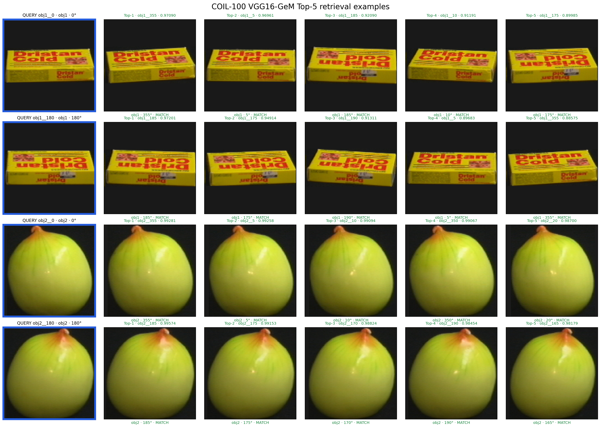
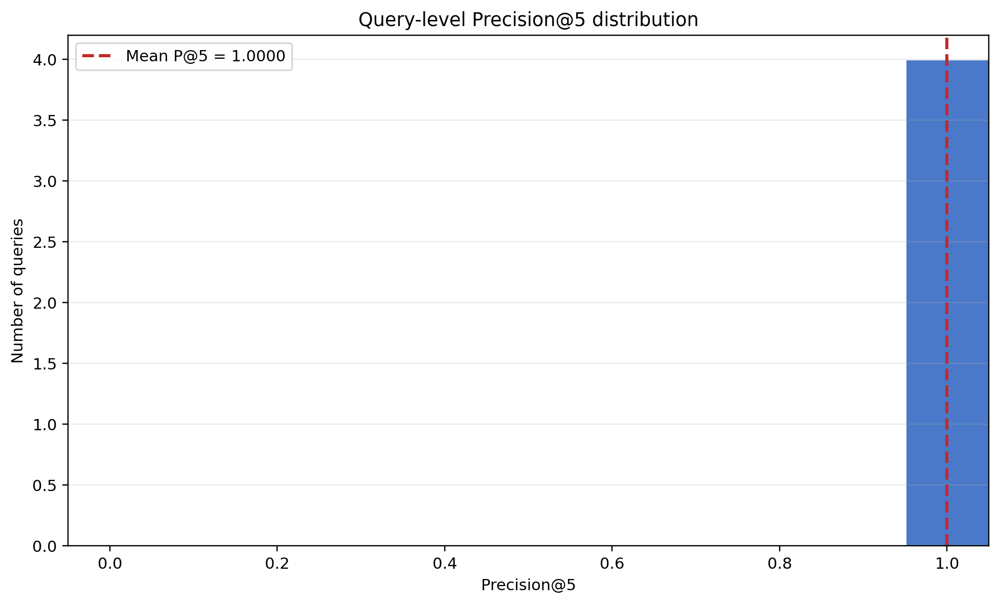
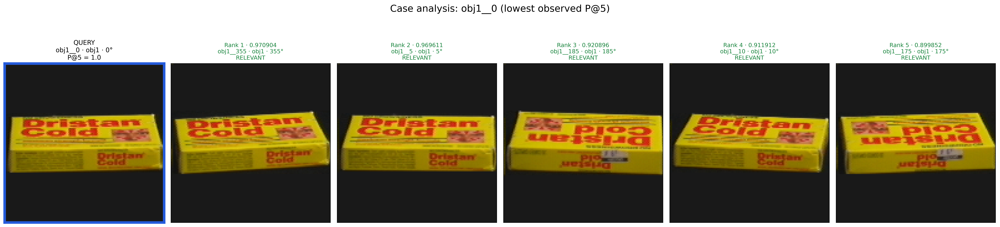

# Lab 1 — COIL-100 Image Retrieval

## Objective

Retrieve the five most visually similar COIL-100 gallery images for each query
using an inference-only pretrained image-retrieval descriptor, then measure
same-object Precision@5.

## Dataset

COIL-100 contains 100 physical objects and 72 RGB views per object (7,200
images, 128 × 128 pixels). The source is the
[Columbia Object Image Library](https://www.cs.columbia.edu/CAVE/software/softlib/coil-100.php).
The fixed split used here has 4 query images (0° and 180° for each
object) and 210 gallery images (the remaining views). Relevance is
defined exclusively by matching object ID. There is no training/validation
split because this experiment performs no model training.

## Method

The network is the authors' pretrained **retrievalSfM120k-vgg16-gem** model: VGG16 with
Generalized-Mean pooling, trained for image retrieval on retrieval-SfM-120k.
RGB images are converted to tensors and normalized using channel mean/std
stored in the official checkpoint. Inference is performed with gradients
disabled. Descriptors are L2-normalized and ranked by cosine similarity
`q · g`; ties are resolved by gallery image ID. Exactly five gallery results
are retained per query.

## Experiment setup

- Python: 3.9.6
- Platform: macOS-26.6.2-arm64-arm-64bit
- Device: mps
- PyTorch: 2.8.0
- Batch size: 8
- Input dimensions: 128x128 RGB
- Descriptor dimensions: 512
- Checkpoint SHA-256: `b4dcdc6b1dc22d9291a27417034a9fa608f697556d26116fafbfa99b5ce0ab95`
- Queries evaluated: 4; gallery images: 210

## Results

Mean P@5 over 4 evaluated queries: **1.0000**.
Queries with P@5 = 1: 4; queries with P@5 = 0: 0.

Example query results (similarity scores and relevance are actual run outputs):

| Query | P@5 | Top-5 gallery results (score, relevance) |
|---|---:|---|
| obj1__0 | 1.0 | obj1__355 (0.97090, relevant), obj1__5 (0.96961, relevant), obj1__185 (0.92090, relevant), obj1__10 (0.91191, relevant), obj1__175 (0.89985, relevant) |
| obj1__180 | 1.0 | obj1__185 (0.97201, relevant), obj1__175 (0.94914, relevant), obj1__190 (0.91311, relevant), obj1__5 (0.89683, relevant), obj1__355 (0.88575, relevant) |
| obj2__0 | 1.0 | obj2__355 (0.99281, relevant), obj2__5 (0.99258, relevant), obj2__10 (0.99094, relevant), obj2__350 (0.99067, relevant), obj2__20 (0.98700, relevant) |
| obj2__180 | 1.0 | obj2__185 (0.99574, relevant), obj2__175 (0.99153, relevant), obj2__170 (0.98824, relevant), obj2__190 (0.98454, relevant), obj2__165 (0.98179, relevant) |

Figure 1. Selected actual queries and their five ranked gallery images. Each result
shows its ID, cosine score and relevance. Images: Columbia COIL-100.

Figure 2. Query-level precision distribution for this run.

Per-query values are in `../metrics/per_query_precision.csv`; all ranked results
are in `../metrics/top5_results.csv`.

All evaluated query-level measurements:

| Query | P@5 |
|---|---:|
| obj1__0 | 1.0 |
| obj1__180 | 1.0 |
| obj2__0 | 1.0 |
| obj2__180 | 1.0 |

## Case analysis

The selected query is **obj1__0** (object 1, angle
0°), with P@5 = 1.0. Its observed ranked results:
rank 1: obj1__355 (object 1, 355°, score 0.970904, relevant); rank 2: obj1__5 (object 1, 5°, score 0.969611, relevant); rank 3: obj1__185 (object 1, 185°, score 0.920896, relevant); rank 4: obj1__10 (object 1, 10°, score 0.911912, relevant); rank 5: obj1__175 (object 1, 175°, score 0.899852, relevant).

Of the five results, 5 depict the query objects; their viewing angles are 355°, 5°, 185°, 10°, 175°. The incorrect results belong to object IDs none. These are direct observations from the ranked output; inspect the case figure to compare appearance and viewpoint before attributing a cause.

Figure 3. Lowest observed P@5, selected deterministically by score then query ID.

Interpret
errors by comparing object appearance and viewpoint in that figure; possible
factors include viewpoint change, shape/texture similarity to another object,
and the difference between COIL-100's turntable imagery and the landmark
retrieval data used to train this descriptor. Do not treat these as proven
causes without visual evidence.

## Limitations

This is a single pretrained model and a single fixed viewpoint split. The gallery
contains neighboring 5° views, so this is a relatively favorable dense-view
protocol and does not establish robustness to large viewpoint gaps. P@5
depends on the definition of relevance and does not capture all ranking
behavior. No model adaptation or parameter tuning is performed. A landmark-
trained embedding may not optimally represent small controlled object images;
qualitative interpretation should be based on the generated case figure.

## References

1. F. Radenović, G. Tolias, and O. Chum, “Fine-Tuning CNN Image Retrieval with
   No Human Annotation,” *IEEE TPAMI*, 41(7), 1655–1668, 2019.
   https://doi.org/10.1109/TPAMI.2018.2846566
2. [Authors' PyTorch implementation](https://github.com/filipradenovic/cnnimageretrieval-pytorch)
   and `retrievalSfM120k-vgg16-gem` checkpoint.
3. S. Nene, S. Nayar, and H. Murase, *Columbia Object Image Library (COIL-100)*,
   Columbia University.
