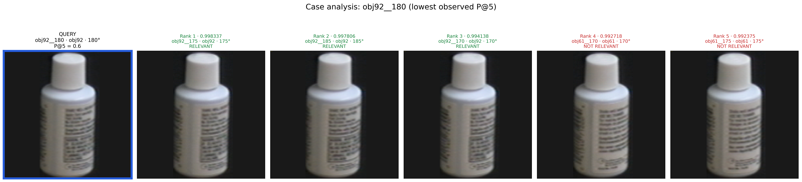

# Multimedia course laboratories

Repository for the individual Multimedia assignments. Current authorized stage: **Lab 1 — image retrieval using GeM on COIL-100**.

- [Lab 1](1-image-retrieval/README.md): implementation, tests, actual measurements and figures.
- [Lab 2](2-video-retrieval/README.md): future scope only; requires explicit approval.
- [Lab 3](3-video-summarization/README.md): future scope only; requires explicit approval.
- `reports/`: Lab 1 draft now; a combined Word report is deferred until all three labs are approved.
- `docs/`: implementation audit, experiment log, AI assistance provenance.

Do not start Lab 2 until the user explicitly approves Lab 1. Do not start Lab 3 until the user explicitly approves Lab 2.

## Lab 1 result — awaiting explicit review

All **7,200** COIL-100 images were validated; **200** query views were ranked
against **7,000** gallery views using the authors' VGG16-GeM checkpoint.
**Mean P@5: 0.9970**; 198 queries achieved 1.0. The independent verifier checked
all 1,000 returned positions and exact cosine rankings. All 18 tests passed
with real-asset checks included. See [Lab 1 report draft](reports/lab1_report.md),
[experiment summary](1-image-retrieval/results/summary.md),
[experiment log](docs/experiment_log.md) and [AI records](docs/ai_usage.md).

The final combined Word document has not been generated. Labs 2/3 contain only
scope placeholders. No TVSum/DSNet resources were downloaded. This stage stops
for explicit Lab 1 approval.
