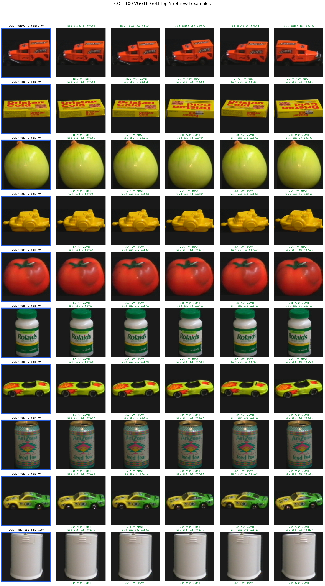
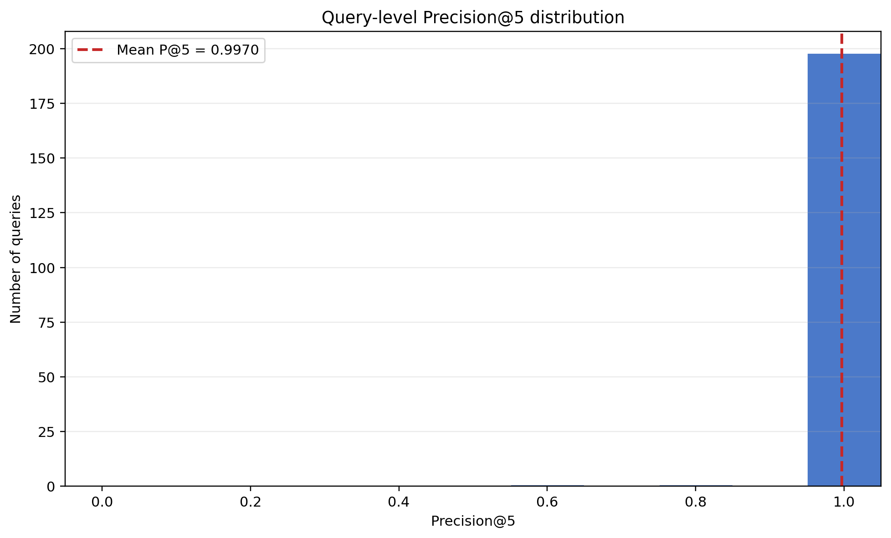
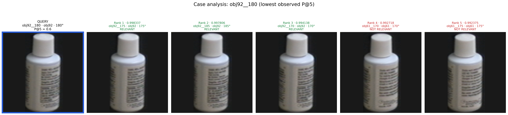

# Lab 1 — COIL-100 Image Retrieval

## Objective

Retrieve the five most visually similar COIL-100 gallery images for each query
using an inference-only pretrained image-retrieval descriptor, then measure
same-object Precision@5.

## Dataset

COIL-100 contains 100 physical objects and 72 RGB views per object (7,200
images, 128 × 128 pixels). The source is the
[Columbia Object Image Library](https://www.cs.columbia.edu/CAVE/software/softlib/coil-100.php).
The fixed split used here has 200 query images (0° and 180° for each
object) and 7000 gallery images (the remaining views). Relevance is
defined exclusively by matching object ID. There is no training/validation
split because this experiment performs no model training.

## Method

The network is the authors' pretrained **retrievalSfM120k-vgg16-gem** model: VGG16 with
Generalized-Mean pooling, trained for image retrieval on retrieval-SfM-120k.
The learned GeM exponent is **2.9208486080169678**, with epsilon 1e-6; this is not
average pooling. The unmodified authors' network source is pinned to revision
`1e66a417afa2247edde6d35f3a9a2a465778a3a8`. No multiscale aggregation or additional discriminative
whitening is applied. Images stay at native 128×128 resolution, an explicit
choice differing from resized evaluation settings.
RGB images are converted to tensors and normalized using channel mean/std
stored in the official checkpoint. Inference is performed with gradients
disabled. Descriptors are L2-normalized and ranked by cosine similarity
`q · g`; ties are resolved by gallery image ID. Exactly five gallery results
are retained per query.

## Experiment setup

- Python: 3.9.6
- Platform: macOS-26.6.2-arm64-arm-64bit
- Device: mps
- PyTorch: 2.8.0
- Batch size: 16
- Input dimensions: 128x128 RGB
- Descriptor dimensions: 512
- Checkpoint SHA-256: `b4dcdc6b1dc22d9291a27417034a9fa608f697556d26116fafbfa99b5ce0ab95`
- Queries evaluated: 200; gallery images: 7000

## Results

Mean P@5 over 200 evaluated queries: **0.9970**.
Queries with P@5 = 1: 198; queries with P@5 = 0: 0.

Example query results (similarity scores and relevance are actual run outputs):

| Query | P@5 | Top-5 gallery results (score, relevance) |
|---|---:|---|
| obj1__0 | 1.0 | obj1__355 (0.97090, relevant), obj1__5 (0.96961, relevant), obj1__185 (0.92090, relevant), obj1__10 (0.91191, relevant), obj1__175 (0.89985, relevant) |
| obj1__180 | 1.0 | obj1__185 (0.97201, relevant), obj1__175 (0.94914, relevant), obj1__190 (0.91311, relevant), obj1__5 (0.89683, relevant), obj1__355 (0.88575, relevant) |
| obj2__0 | 1.0 | obj2__355 (0.99281, relevant), obj2__5 (0.99258, relevant), obj2__10 (0.99094, relevant), obj2__350 (0.99067, relevant), obj2__20 (0.98700, relevant) |
| obj2__180 | 1.0 | obj2__185 (0.99574, relevant), obj2__175 (0.99153, relevant), obj2__170 (0.98824, relevant), obj2__190 (0.98454, relevant), obj2__165 (0.98179, relevant) |
| obj3__0 | 1.0 | obj3__5 (0.99149, relevant), obj3__355 (0.99038, relevant), obj3__10 (0.97884, relevant), obj3__350 (0.96859, relevant), obj3__15 (0.96057, relevant) |



Figure 1. Selected actual queries and their five ranked gallery images. Each result
shows its ID, cosine score and relevance. Images: Columbia COIL-100.



Figure 2. Query-level precision distribution for this run.

Per-query values are in `../1-image-retrieval/results/metrics/per_query_precision.csv`; all ranked results
are in `../1-image-retrieval/results/metrics/top5_results.csv`.

All evaluated query-level measurements:

| Query | P@5 |
|---|---:|
| obj100__0 | 1.0 |
| obj100__180 | 1.0 |
| obj10__0 | 1.0 |
| obj10__180 | 1.0 |
| obj11__0 | 1.0 |
| obj11__180 | 1.0 |
| obj12__0 | 1.0 |
| obj12__180 | 1.0 |
| obj13__0 | 1.0 |
| obj13__180 | 1.0 |
| obj14__0 | 1.0 |
| obj14__180 | 1.0 |
| obj15__0 | 1.0 |
| obj15__180 | 1.0 |
| obj16__0 | 1.0 |
| obj16__180 | 1.0 |
| obj17__0 | 1.0 |
| obj17__180 | 1.0 |
| obj18__0 | 1.0 |
| obj18__180 | 1.0 |
| obj19__0 | 1.0 |
| obj19__180 | 1.0 |
| obj1__0 | 1.0 |
| obj1__180 | 1.0 |
| obj20__0 | 1.0 |
| obj20__180 | 1.0 |
| obj21__0 | 1.0 |
| obj21__180 | 1.0 |
| obj22__0 | 1.0 |
| obj22__180 | 1.0 |
| obj23__0 | 1.0 |
| obj23__180 | 1.0 |
| obj24__0 | 1.0 |
| obj24__180 | 1.0 |
| obj25__0 | 1.0 |
| obj25__180 | 1.0 |
| obj26__0 | 1.0 |
| obj26__180 | 1.0 |
| obj27__0 | 1.0 |
| obj27__180 | 1.0 |
| obj28__0 | 1.0 |
| obj28__180 | 1.0 |
| obj29__0 | 1.0 |
| obj29__180 | 1.0 |
| obj2__0 | 1.0 |
| obj2__180 | 1.0 |
| obj30__0 | 1.0 |
| obj30__180 | 1.0 |
| obj31__0 | 1.0 |
| obj31__180 | 1.0 |
| obj32__0 | 1.0 |
| obj32__180 | 1.0 |
| obj33__0 | 1.0 |
| obj33__180 | 1.0 |
| obj34__0 | 1.0 |
| obj34__180 | 1.0 |
| obj35__0 | 1.0 |
| obj35__180 | 1.0 |
| obj36__0 | 1.0 |
| obj36__180 | 1.0 |
| obj37__0 | 1.0 |
| obj37__180 | 1.0 |
| obj38__0 | 1.0 |
| obj38__180 | 1.0 |
| obj39__0 | 1.0 |
| obj39__180 | 1.0 |
| obj3__0 | 1.0 |
| obj3__180 | 1.0 |
| obj40__0 | 1.0 |
| obj40__180 | 1.0 |
| obj41__0 | 1.0 |
| obj41__180 | 1.0 |
| obj42__0 | 1.0 |
| obj42__180 | 1.0 |
| obj43__0 | 1.0 |
| obj43__180 | 1.0 |
| obj44__0 | 1.0 |
| obj44__180 | 1.0 |
| obj45__0 | 1.0 |
| obj45__180 | 1.0 |
| obj46__0 | 1.0 |
| obj46__180 | 1.0 |
| obj47__0 | 1.0 |
| obj47__180 | 1.0 |
| obj48__0 | 1.0 |
| obj48__180 | 1.0 |
| obj49__0 | 1.0 |
| obj49__180 | 1.0 |
| obj4__0 | 1.0 |
| obj4__180 | 1.0 |
| obj50__0 | 1.0 |
| obj50__180 | 1.0 |
| obj51__0 | 1.0 |
| obj51__180 | 1.0 |
| obj52__0 | 1.0 |
| obj52__180 | 1.0 |
| obj53__0 | 1.0 |
| obj53__180 | 1.0 |
| obj54__0 | 1.0 |
| obj54__180 | 1.0 |
| obj55__0 | 1.0 |
| obj55__180 | 1.0 |
| obj56__0 | 1.0 |
| obj56__180 | 1.0 |
| obj57__0 | 1.0 |
| obj57__180 | 1.0 |
| obj58__0 | 1.0 |
| obj58__180 | 1.0 |
| obj59__0 | 1.0 |
| obj59__180 | 1.0 |
| obj5__0 | 1.0 |
| obj5__180 | 1.0 |
| obj60__0 | 1.0 |
| obj60__180 | 1.0 |
| obj61__0 | 1.0 |
| obj61__180 | 1.0 |
| obj62__0 | 1.0 |
| obj62__180 | 1.0 |
| obj63__0 | 1.0 |
| obj63__180 | 1.0 |
| obj64__0 | 1.0 |
| obj64__180 | 1.0 |
| obj65__0 | 1.0 |
| obj65__180 | 1.0 |
| obj66__0 | 1.0 |
| obj66__180 | 1.0 |
| obj67__0 | 1.0 |
| obj67__180 | 1.0 |
| obj68__0 | 1.0 |
| obj68__180 | 1.0 |
| obj69__0 | 1.0 |
| obj69__180 | 1.0 |
| obj6__0 | 1.0 |
| obj6__180 | 1.0 |
| obj70__0 | 1.0 |
| obj70__180 | 1.0 |
| obj71__0 | 1.0 |
| obj71__180 | 1.0 |
| obj72__0 | 1.0 |
| obj72__180 | 1.0 |
| obj73__0 | 1.0 |
| obj73__180 | 1.0 |
| obj74__0 | 1.0 |
| obj74__180 | 1.0 |
| obj75__0 | 1.0 |
| obj75__180 | 1.0 |
| obj76__0 | 1.0 |
| obj76__180 | 1.0 |
| obj77__0 | 1.0 |
| obj77__180 | 1.0 |
| obj78__0 | 1.0 |
| obj78__180 | 1.0 |
| obj79__0 | 1.0 |
| obj79__180 | 1.0 |
| obj7__0 | 1.0 |
| obj7__180 | 1.0 |
| obj80__0 | 1.0 |
| obj80__180 | 1.0 |
| obj81__0 | 1.0 |
| obj81__180 | 1.0 |
| obj82__0 | 1.0 |
| obj82__180 | 1.0 |
| obj83__0 | 1.0 |
| obj83__180 | 1.0 |
| obj84__0 | 1.0 |
| obj84__180 | 1.0 |
| obj85__0 | 1.0 |
| obj85__180 | 1.0 |
| obj86__0 | 1.0 |
| obj86__180 | 1.0 |
| obj87__0 | 1.0 |
| obj87__180 | 1.0 |
| obj88__0 | 1.0 |
| obj88__180 | 1.0 |
| obj89__0 | 1.0 |
| obj89__180 | 1.0 |
| obj8__0 | 1.0 |
| obj8__180 | 1.0 |
| obj90__0 | 1.0 |
| obj90__180 | 1.0 |
| obj91__0 | 1.0 |
| obj91__180 | 1.0 |
| obj92__0 | 1.0 |
| obj92__180 | 0.6 |
| obj93__0 | 1.0 |
| obj93__180 | 1.0 |
| obj94__0 | 1.0 |
| obj94__180 | 1.0 |
| obj95__0 | 1.0 |
| obj95__180 | 1.0 |
| obj96__0 | 1.0 |
| obj96__180 | 1.0 |
| obj97__0 | 1.0 |
| obj97__180 | 1.0 |
| obj98__0 | 1.0 |
| obj98__180 | 0.8 |
| obj99__0 | 1.0 |
| obj99__180 | 1.0 |
| obj9__0 | 1.0 |
| obj9__180 | 1.0 |

## Case analysis

The selected query is **obj92__180** (object 92, angle
180°), with P@5 = 0.6. Its observed ranked results:
rank 1: obj92__175 (object 92, 175°, score 0.998337, relevant); rank 2: obj92__185 (object 92, 185°, score 0.997806, relevant); rank 3: obj92__170 (object 92, 170°, score 0.994138, relevant); rank 4: obj61__170 (object 61, 170°, score 0.992718, not relevant); rank 5: obj61__175 (object 61, 175°, score 0.992375, not relevant).

Of the five results, 3 depict the query objects; their viewing angles are 175°, 185°, 170°. The incorrect results belong to object ID 61. These are direct observations from the ranked output; inspect the case figure to compare appearance and viewpoint before attributing a cause.



Figure 3. Lowest observed P@5, selected deterministically by score then query ID.

Interpret
errors by comparing object appearance and viewpoint in that figure; possible
factors include viewpoint change, shape/texture similarity to another object,
and the difference between COIL-100's turntable imagery and the landmark
retrieval data used to train this descriptor. Do not treat these as proven
causes without visual evidence.

## Limitations

This is a single pretrained model and a single fixed viewpoint split. The gallery
contains neighboring 5° views, so this is a relatively favorable dense-view
protocol and does not establish robustness to large viewpoint gaps. P@5
depends on the definition of relevance and does not capture all ranking
behavior. No model adaptation or parameter tuning is performed. A landmark-
trained embedding may not optimally represent small controlled object images;
qualitative interpretation should be based on the generated case figure.

## References

1. F. Radenović, G. Tolias, and O. Chum, “Fine-Tuning CNN Image Retrieval with
   No Human Annotation,” *IEEE TPAMI*, 41(7), 1655–1668, 2019.
   https://doi.org/10.1109/TPAMI.2018.2846566
2. [Authors' PyTorch implementation](https://github.com/filipradenovic/cnnimageretrieval-pytorch)
   and `retrievalSfM120k-vgg16-gem` checkpoint.
3. S. Nene, S. Nayar, and H. Murase, *Columbia Object Image Library (COIL-100)*,
   Columbia University.

## Visual interpretation checked in this session

The lowest-P@5 case `obj92__180` is a white cylindrical bottle with a pale cap
and dense dark label printing. Its first three results show object 92 at 175°,
185° and 170°, all close to the 180° query view. Ranks 4 and 5 instead show
object 61 at 170° and 175°. These wrong-object images share the white bottle
silhouette, cap shape and small label text visible in the query. Their scores
(0.992718 and 0.992375) are close to the third correct result (0.994138).
The observed visual resemblance is consistent with confusion between distinct
COIL object identities; this does not establish which particular visual feature
caused the network's ranking. At 128×128 resolution, subtle identity differences
may be difficult for a global 512-dimensional descriptor to preserve. The model
was trained on retrieval-SfM imagery rather than these controlled tabletop
objects, which is another plausible limitation, not a measured causal effect.

The other imperfect query is `obj98__180` (P@5 0.8). All other 198 queries
achieved P@5 1.0. Across 1,000 returned slots, 997 were relevant, consistent
with mean P@5 0.9970. High performance is supported by the dense gallery:
each query has same-object views only 5° away. This experiment does not test
large view gaps, changed illumination/backgrounds or unseen object identities.

## Reproduction and validation

The measured final run used CPython 3.9.6, torch 2.8.0, torchvision 0.23.0,
NumPy 1.26.4 and Apple MPS, batch size 16. All dependencies are pinned in
`1-image-retrieval/requirements-lock.txt`. No parameters were selected using
COIL retrieval results, and there was no training or COIL fine-tuning.
The full run took 54.7154 s, including 44.9553 s for descriptor extraction.
Run times describe this execution, not expected performance on other devices.

From `1-image-retrieval/`, activate an environment installed from requirements
and execute:

```bash
export MPLCONFIGDIR="$PWD/.mplconfig"
python scripts/prepare_dataset.py
python scripts/run_experiment.py --batch-size 16 --device mps
python -m pytest -q
python scripts/verify_results.py --descriptors
```

Use `--device cpu` on a machine without Apple MPS; small numerical differences
across devices are possible. The verifier checks saved outputs independently
of the retrieval helper. The saved run records source commit
`4144793d2b766da136489e8a69a2e3ffd271379d`, checkpoint SHA-256, all 7,200-image
inventory/fingerprint, command, exact versions, timestamps and device.

The initial four-query/210-gallery smoke run scored 1.0000 and is retained
separately under `results/smoke/`. It is not used as final benchmark evidence.
Detailed tests, compatibility fixes and environment download issues appear in
`docs/experiment_log.md`; no results were invented to replace failed attempts.

This is a **Lab 1-only Markdown report draft**. It is ready to incorporate into
the final Word report after the later labs are authorized and completed. No
final three-lab Word document has been generated. The student should review the
figures, interpretation and genuine AI interaction records before submission.
