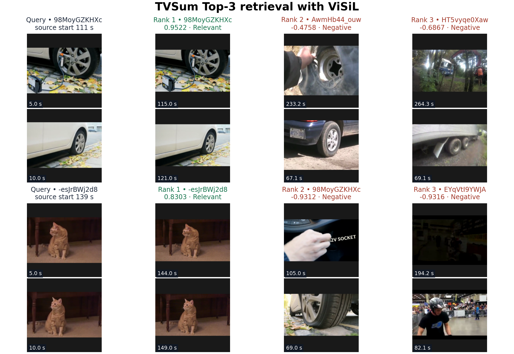
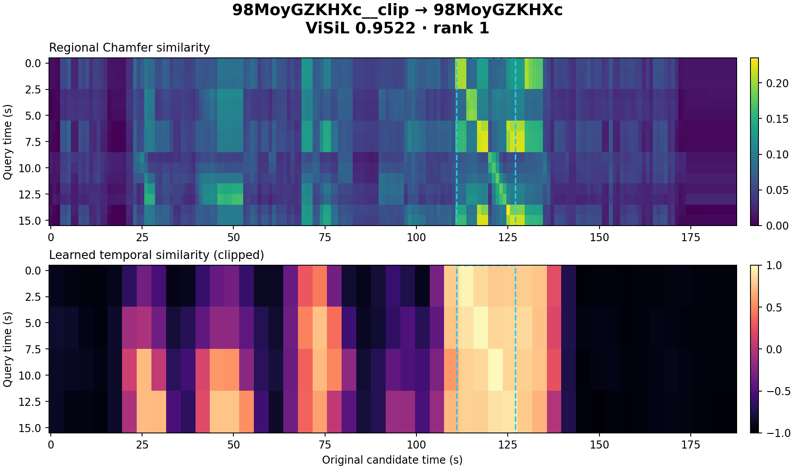

# Lab 2 — Video retrieval with ViSiL (draft)

The objective was to retrieve original video sources from transformed
clips using the pretrained ViSiL model. On the 20-video TVSum gallery,
ViSiL retrieved the overlapping original at rank 1 for all 10 queries.
The measured **Top-3 Hit Rate was 10/10 (100%)**.

## Dataset and retrieval protocol

The official TVSum 1.1 release contains 50 videos across 10 categories.
The local originals total **681,259,038 bytes** (649.7 MiB) and about
209.7 minutes. All 50 files matched the release metadata, opened in OpenCV,
and decoded a first frame. The manifest records every ID, title, category,
source URL, dimensions, average frame rate, nominal duration, size, and
checksum. [TVSum 1.1 release](https://people.csail.mit.edu/yalesong/tvsum/) ·
[TVSum manifest](../2-video-retrieval/results/metrics/tvsum_manifest.csv)

The gallery uses the two lexicographically first IDs in each category,
giving 20 full-length originals. The first ID in each category supplies one
16-second interior query clip. The start is
`round(fraction × (source duration − 16))`, cycling through 0.25, 0.45 and
0.65 by alphabetical category. Each clip removes about 8% of the image
from the left, scales to 240 pixels high, and is re-encoded as muted H.264
at CRF 26. The source original is the relevant candidate because it
contains the exact scene represented by the clip. Nineteen other
originals per query serve as negatives, including a same-category
original. Every clip and source time interval is recorded in the protocol.
[Evaluation protocol](../2-video-retrieval/results/metrics/protocol.json)

The smoke run used BK and BT with 2 queries against 4 originals. The full
run compared 10 clips against 20 originals for 200 scored pairs. It
traversed 115,960 decoded original frames and 4,461 query frames, using
4,163 and 160 sampled frames respectively. All selected gallery frame
counts matched the encoded counts in the manifest.

## ViSiL model and preprocessing

OpenCV samples RGB frames at a cadence of `round(fps)` decoded frames,
approximately one frame per second. The authors' saved graph handles
bilinear resize to a short edge of 256 pixels, a 224 × 224 center crop,
and RGB mean subtraction. ResNet-50 produces nine regional descriptors
per sampled frame, with 3,840 components per region. The checkpoint
includes PCA whitening, regional attention, and a learned temporal
comparator.

For a query frame and candidate frame, ViSiL takes the dot product between
each pair of region descriptors. It keeps the best candidate-region match
per query region and averages over query regions. This directional
Chamfer reduction forms the frame similarity matrix. The four-layer
comparator acts on that matrix, with two max-pooling stages downsampling
both axes by a factor of four. The graph clips the temporal scores to
[−1, 1], takes the maximum along candidate time for each query row, and
averages the row maxima. This directional aggregation lets a short query
score highly against a full-length original when its sampled scenes
match in the candidate. [ViSiL paper](https://arxiv.org/abs/1908.07410)

We restored the authors' TensorFlow 1 inference graph and pretrained
weights from `ckpt/resnet/model` using TensorFlow 2.16.2's
`tf.compat.v1` API. The loader clears the serialized GPU placements and
runs the published graph on CPU in 16-frame batches. The inspected
TensorFlow source revision is
`0971e54fb8325fceb1bc9748ecbfe4c66e5dabd2`. The model and graph digests,
Python version and platform are in the run metadata.
[Reference implementation](https://github.com/MKLab-ITI/visil/tree/0971e54fb8325fceb1bc9748ecbfe4c66e5dabd2) ·
[Author's checkpoint mirror](https://github.com/MKLab-ITI/visil/issues/24) ·
[Run metadata](../2-video-retrieval/results/metrics/experiment_metrics.json)

## Retrieval results

A query is a hit when any of its first three candidates is relevant.
The smoke run measured **2/2 (100%)**. The full run measured
**10/10 (100%)**, with every relevant candidate at rank 1. The table gives
ViSiL similarities rounded to four decimal places. Bold candidates are
relevant, and the CSV records full score precision and per-query hit flags.
[Top-3 results](../2-video-retrieval/results/metrics/top3.csv) ·
[All 200 rankings](../2-video-retrieval/results/metrics/all_rankings.csv)

| Query ID | Source start (s) | Rank 1 | Rank 2 | Rank 3 |
|---|---:|---|---|---|
| `EE-bNr36nyA__clip` | 21 | **`EE-bNr36nyA` (0.9070)** | `Hl-__g2gn_A` (-0.7649) | `Se3oxnaPsz0` (-0.7678) |
| `EYqVtI9YWJA__clip` | 82 | **`EYqVtI9YWJA` (0.8730)** | `4wU_LUjG5Ic` (-0.7462) | `JKpqYvAdIsw` (-0.8341) |
| `-esJrBWj2d8__clip` | 139 | **`-esJrBWj2d8` (0.8303)** | `98MoyGZKHXc` (-0.9312) | `EYqVtI9YWJA` (-0.9316) |
| `JKpqYvAdIsw__clip` | 34 | **`JKpqYvAdIsw` (0.8667)** | `VuWGsYPqAX8` (-0.2377) | `91IHQYk1IQM` (-0.3031) |
| `0tmA_C6XwfM__clip` | 56 | **`0tmA_C6XwfM` (0.8554)** | `AwmHb44_ouw` (-0.6743) | `Se3oxnaPsz0` (-0.7166) |
| `37rzWOQsNIw__clip` | 114 | **`37rzWOQsNIw` (0.8497)** | `AwmHb44_ouw` (-0.8575) | `Hl-__g2gn_A` (-0.8789) |
| `GsAD1KT1xo8__clip` | 32 | **`GsAD1KT1xo8` (0.8868)** | `PJrm840pAUI` (-0.3983) | `VuWGsYPqAX8` (-0.4669) |
| `4wU_LUjG5Ic__clip` | 68 | **`4wU_LUjG5Ic` (0.8583)** | `Hl-__g2gn_A` (-0.7156) | `JgHubY5Vw3Y` (-0.7537) |
| `98MoyGZKHXc__clip` | 111 | **`98MoyGZKHXc` (0.9522)** | `AwmHb44_ouw` (-0.4758) | `HT5vyqe0Xaw` (-0.6867) |
| `HT5vyqe0Xaw__clip` | 77 | **`HT5vyqe0Xaw` (0.8704)** | `GsAD1KT1xo8` (-0.8078) | `98MoyGZKHXc` (-0.8601) |

## Representative frames

For each of the two representative query frames, the candidate panels show
the gallery frame with the highest raw regional Chamfer similarity. The
tyre-repair query `98MoyGZKHXc__clip` retrieved its source at 0.9522,
including the wheel, pavement, fallen leaves, and tyre inflator seen in the
clip. The same-category candidate `AwmHb44_ouw` contains wheels filmed from
other angles, and ranks second at −0.4758. The two best individual frame
matches in that negative come from about 233.2 s and 67.1 s, in reverse
order across the two depicted query frames. Shared objects can look
similar in isolation while providing weaker evidence across time.

The cat query `-esJrBWj2d8__clip` had the lowest relevant score at 0.8303
and still ranked its original first. The cat and chair match at 144 and
149 s in the gallery, consistent with the query's 139 s start and the
two sample offsets of 5 and 10 s. The crop changes the framing while
preserving the scene and its viewpoint.

## Temporal similarity

The upper panel shows the actual 16 × 188 frame similarity matrix for
the tyre-repair clip. Its brightest matches form a roughly diagonal band
inside the 111–127 s overlap. The lower panel shows the clipped 4 × 47
temporal output. The maxima for its four query rows occur in candidate
bins starting at 112, 116, 120 and 124 s. Their mean is 0.9522336, matching
the exported rank-1 score within floating-point rounding. The dashed
lines mark the known clip interval. Other elevated blocks reflect
visually similar frames elsewhere in the original, so the heatmap
shows correspondence evidence rather than a hard segment boundary.
[Exported matrices](../2-video-retrieval/results/metrics/heatmap_pair.json) ·
[Independent verification](../2-video-retrieval/results/metrics/verification.json)

## Limitations

The evaluation measures retrieval of crops and re-encodes from known
originals in a gallery of 20 videos. Independently filmed viewpoints,
large edits, time warping, and retrieval at larger gallery sizes remain
untested. Near-1 Hz sampling can miss brief scene matches. The Top-3
metric measures whether the correct source is returned, while exact
interval localization would require a separate evaluation.

## References and attribution

- Kordopatis-Zilos, G., Papadopoulos, S., Patras, I., and Kompatsiaris, I.
  (2019). *ViSiL: Fine-grained Spatio-Temporal Video Similarity Learning*.
  ICCV. [Paper](https://arxiv.org/abs/1908.07410) ·
  [Authors' implementation and Apache 2.0 license](https://github.com/MKLab-ITI/visil)
- Song, Y., Vallmitjana, J., Stent, A., and Jaimes, A. (2015).
  *TVSum: Summarizing Web Videos Using Titles*. CVPR, 5179–5187.
  [Paper](https://openaccess.thecvf.com/content_cvpr_2015/html/Song_TVSum_Summarizing_Web_2015_CVPR_paper.html) ·
  [Dataset and video license information](https://github.com/yalesong/tvsum)
- Figure frames are from the TVSum source videos identified in their
  panels. Original titles and creator video URLs are preserved in
  the [dataset manifest](../2-video-retrieval/results/metrics/tvsum_manifest.csv).
