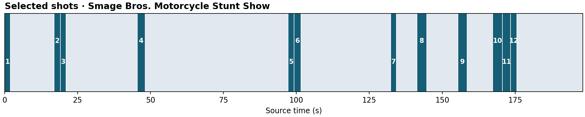
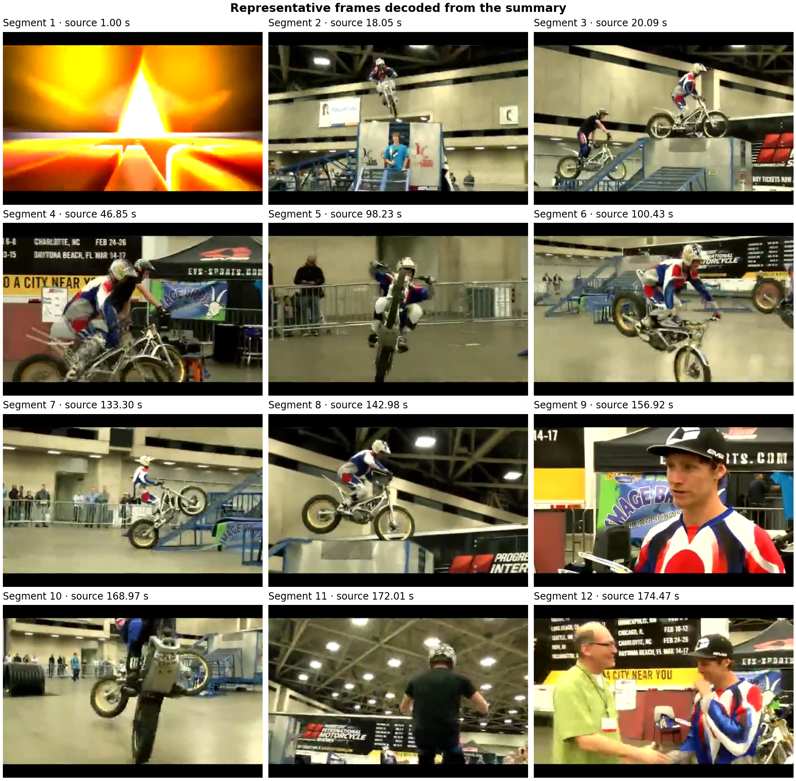
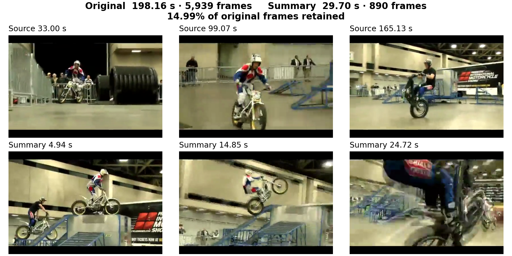
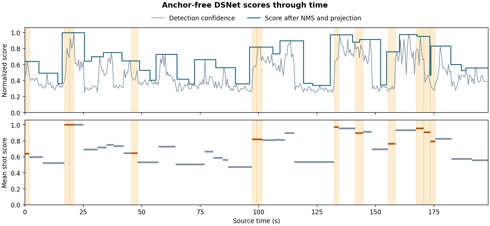

# Lab 3 — Video summarization with anchor-free DSNet (draft)

The objective was to create a chronological, silent, extractive summary
from a complete TVSum video using the authors' pretrained anchor-free
DSNet. The summary retains **890 of 5,939 decoded source frames
(14.9857%)** and runs for **29.696 s**. It meets the 15% frame limit.

## Source video and feature identity

The selected TVSum 1.1 video is *Smage Bros. Motorcycle Stunt Show*
(`EYqVtI9YWJA`, category BT). It contains visually distinct jumps,
platform maneuvers, and riding sequences that can be inspected with the
sound muted. The complete source file occupies 10,713,251 bytes. It
decodes to 5,939 frames at 30,000/1,001 fps, with a 540 × 360 resolution
and 198.165 s duration. The original media was reused from the local
TVSum cache. [Official TVSum release](https://people.csail.mit.edu/yalesong/tvsum/) ·
[Original video](https://www.youtube.com/watch?v=EYqVtI9YWJA)

DSNet's published TVSum HDF5 (125,126,256 bytes) provides one 1,024-D
GoogLeNet pool5 descriptor every 15 original frames. The complete
selected record, `video_42`, contains 396 vectors, picks from frame 0
through 5,925, and 40 source shots. Each vector covers source frames
from its pick up to the next pick, with the last vector covering through
frame 5,938. The 42nd entry in the official TVSum catalog is the selected
video. Its decoded frame count and 20 official annotation lengths match
the HDF5 frame count. The average official annotation at the HDF5 picks
correlates with the HDF5 ground-truth trace at **r = 1.0000** to four
decimals. The annotations corroborate identity before inference.
[Run metadata](../3-video-summarization/results/metrics/experiment_metrics.json) ·
[DSNet feature release](https://github.com/li-plus/DSNet#datasets-preparation)

## Pretrained model and procedure

The model is the authors' basic anchor-free DSNet attention architecture
from revision `1804176e2e8b57846beb063667448982273fca89`. It uses eight
attention heads and a 128-unit hidden layer. The official checkpoint
`pretrain_af_basic/checkpoint/tvsum.yml.3.pt` (17,315,936 bytes) was
restored strictly in PyTorch 2.8.0 and run on CPU. The checkpoint matches
zero-based TVSum fold 3. The video is in the fold's `test_keys`, which
the authors' training script uses for validation and checkpoint selection.
The result is a single validation-video demonstration.
[Official implementation](https://github.com/li-plus/DSNet/tree/1804176e2e8b57846beb063667448982273fca89) ·
[Reference training script](https://github.com/li-plus/DSNet/blob/1804176e2e8b57846beb063667448982273fca89/src/anchor_free/train.py)

1. The model predicts importance, centerness, and left and right temporal
   offsets for each of the 396 feature positions. It uses the product of
   importance and centerness, normalized by the maximum.
2. The offsets become temporal intervals in feature coordinates. The
   intervals are clipped and rounded. The authors' temporal NMS at
   IoU 0.4 retains 35 detections.
3. Each bin receives the highest surviving confidence that covers it.
   The bins are projected onto original frames using the HDF5 picks,
   and each released shot receives its mean frame score.
4. Zero-one knapsack maximizes the sum of integer shot values
   `int(1000 × mean score)` with a frame budget of
   `floor(0.15 × 5,939) = 890`. The selected whole shots total exactly
   890 frames and require no trimming.
5. FFmpeg extracts the frame intervals chronologically and encodes one
   silent H.264 MP4 at the original frame rate. Independent PyAV decoding
   checks the MP4 and compares its frames with the expected source frames.

## Selected segments and measured output

The table uses zero-based frame indices, inclusive starts and exclusive
ends. Times are relative to the complete source. Scores are the mean
DSNet-derived frame scores of the chosen shots.

| Segment | Source frames [start, end) | Source start (s) | Source end (s) | Frames | Score |
|---:|---|---:|---:|---:|---:|
| 1 | 0–60 | 0.000 | 2.002 | 60 | 0.6394 |
| 2 | 510–573 | 17.017 | 19.119 | 63 | 1.0000 |
| 3 | 573–631 | 19.119 | 21.054 | 58 | 1.0000 |
| 4 | 1364–1444 | 45.512 | 48.181 | 80 | 0.6461 |
| 5 | 2914–2975 | 97.230 | 99.266 | 61 | 0.8191 |
| 6 | 2975–3045 | 99.266 | 101.602 | 70 | 0.8191 |
| 7 | 3965–4025 | 132.299 | 134.301 | 60 | 0.9714 |
| 8 | 4235–4336 | 141.308 | 144.678 | 101 | 0.8960 |
| 9 | 4658–4749 | 155.422 | 158.458 | 91 | 0.7622 |
| 10 | 5015–5113 | 167.334 | 170.604 | 98 | 0.9558 |
| 11 | 5113–5198 | 170.604 | 173.440 | 85 | 0.9078 |
| 12 | 5198–5261 | 173.440 | 175.542 | 63 | 0.7917 |

| Measurement | Original | Summary |
|---|---:|---:|
| Independently decoded frames | 5,939 | 890 |
| Duration (s) | 198.165 | 29.696 |
| Frame rate (fps) | 30,000/1,001 | 30,000/1,001 |
| Resolution | 540 × 360 | 540 × 360 |
| Audio streams | 1 | 0 |

The independent verifier matched all **890 output frames** with the
corresponding source positions in chronological order. The mean absolute
8-bit luma error after downsampling averaged 0.234, with a maximum of
0.459 across frames after H.264 re-encoding.
[Selected segments](../3-video-summarization/results/metrics/selected_segments.csv) ·
[Independent verification](../3-video-summarization/results/metrics/verification.json)

## Visual results

The numbered bars show the source positions of the retained shots.
Shared boundaries mark adjacent selected shots. Skipped portions appear
in gray.

The summary shows an opening title graphic, the riders on the elevated
platform around 17–21 s, wheel lifts around 97–102 s, later ramp moves
and a close-up exchange near the end. The shots read as a silent
stunt-show highlight reel because the riders and indoor course recur
throughout. The cut from the two-second opening graphic to the platform
is abrupt. Adjacent selected shots around 17–21 s and 97–102 s preserve
more of each action's movement.

The original includes approaches and additional riding in the skipped
parts, including the rider near the large tire at 33 s and a wheelie at
165.13 s. The 890-frame budget compresses the approaches, landings and
interview context. The silent close-up conveys a person and setting
while the interview content depends on the original audio.

The score plot distinguishes detection confidence from the scores
projected through NMS and averaged over shots. The platform sequence at
17–21 s has the highest selected shot scores. Some longer shots also
score highly and remain outside the summary because the optimizer
allocates the shared frame budget across whole shots.

## Limitations and reproducibility

This experiment demonstrates one full video from a checkpoint's
validation fold. A cross-video quality estimate would require a separate
evaluation protocol. The decision rule uses visual features and
predefined shot boundaries. Sampling every 15 frames can miss very short
actions. The budget can favor short shots or retain opening graphics, and
the chronological cut supplies limited narrative context.

The MP4 is retained locally at
`3-video-summarization/results/summary.mp4`. The launcher, environment,
metrics, and tests support reproduction. [Lab 3 instructions](../3-video-summarization/README.md)

## References and attribution

- Zhu, W., Lu, J., Li, J., and Zhou, J. (2021). *DSNet: A Flexible
  Detect-to-Summarize Network for Video Summarization*. IEEE Transactions
  on Image Processing 30, 948–962. [Paper and code](https://liplus.me/publication/dsnet/)
- Song, Y., Vallmitjana, J., Stent, A., and Jaimes, A. (2015).
  *TVSum: Summarizing Web Videos Using Titles*. CVPR, 5179–5187.
  [Paper](https://openaccess.thecvf.com/content_cvpr_2015/html/Song_TVSum_Summarizing_Web_2015_CVPR_paper.html) ·
  [Dataset and video licensing](https://github.com/yalesong/tvsum)
- The released feature archive credits Ke Zhang and Wei-Lun Chao for
  the GoogLeNet features and cites *Video Summarization with Long
  Short-Term Memory* (ECCV 2016) and *Deep Reinforcement Learning for
  Unsupervised Video Summarization with Diversity-Representativeness
  Reward* (AAAI 2018). Figure frames come from the original TVSum video
  identified above.
